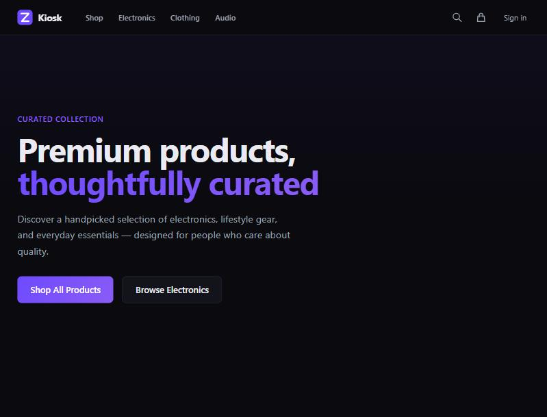

# Kiosk — E-Commerce Platform

> Full-featured online store with product catalog, cart, and admin dashboard, built by [Zolentix](https://zolentix.com)



## Features

- **Product Catalog** — Browse 20+ products with categories, search, and filtering
- **Shopping Cart** — Add/remove items, quantity management, real-time totals
- **Checkout Flow** — Shipping info, order summary, and order confirmation
- **Wishlists** — Save favorite items for later
- **User Auth** — Registration, login, and order history
- **Admin Dashboard** — Revenue KPIs, order management, product CRUD, and inventory
- **Search** — Full-text product search with instant results

## Tech Stack

- **Framework:** Next.js 14 (App Router)
- **Language:** TypeScript
- **Styling:** Tailwind CSS
- **Database:** Prisma ORM + SQLite
- **State:** Zustand
- **Fonts:** Space Grotesk + Inter

## Getting Started

```bash
npm install
npx prisma db push
npx prisma db seed
npm run dev
```

Open [http://localhost:3000](http://localhost:3000) to browse the store.

## License

MIT — [Zolentix](https://zolentix.com)
